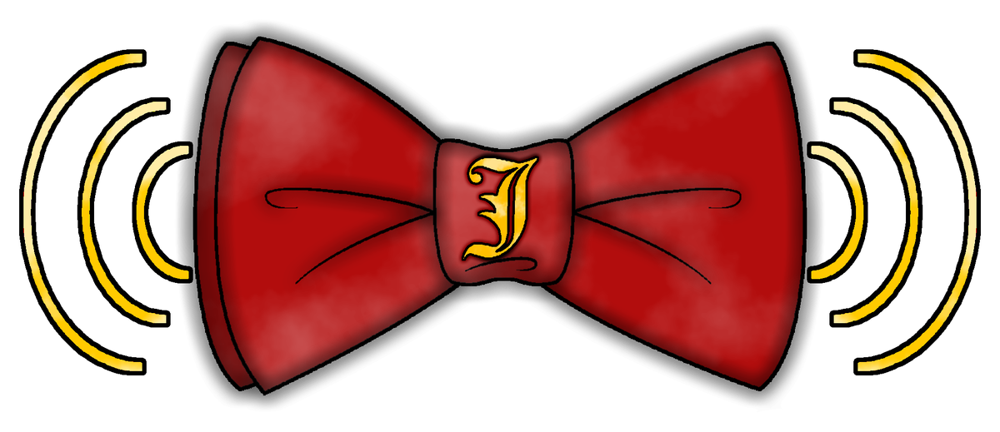

<p align="center"></p>

# Jeeves

A local-first voice assistant for Linux (NixOS). Named agents respond to spoken or typed requests; an intent model maps each request to a function from a user-editable dictionary of composable functions, and runs it.

`SPEC.md` is the authoritative specification. Anything not in `SPEC.md` is out of scope. This README only adds context: status, decisions made while building, and how to install and use it.

## Status

First full implementation of `SPEC.md`: daemon, settings GUI, on-screen overlay, the function dictionary with every listed function, a NixOS module and a test suite (450 tests). See [Verified vs. not](#verified-vs-not) for what has run on real hardware and what hasn't.

## Installing (NixOS)

```nix
{
  inputs.jeeves.url = "github:mr-tinkle-winkle/jeeves";
  inputs.jeeves.inputs.nixpkgs.follows = "nixpkgs";

  outputs = { nixpkgs, jeeves, ... }: {
    nixosConfigurations.yourhost = nixpkgs.lib.nixosSystem {
      system = "x86_64-linux";
      modules = [
        ./configuration.nix
        jeeves.nixosModules.default
        {
          services.jeeves = {
            enable = true;
            user = "yourname";
            # Optional. Every key set here is LOCKED in the GUI.
            settings = {
              models.stt.model = "whisper-base-en";
              run_command.trusted = [ "puppetry --list" ];
            };
            # geminiApiKeyFile = "/run/secrets/gemini";
          };
        }
      ];
    };
  };
}
```

Rebuild, then log out and back in (the `input` group needs a new session). The daemon runs as `systemctl --user status jeeves`; open the settings with `jeeves` or **Jeeves** in the app launcher.

First run: **Models** → download a wake word model (Vosk small), a speech-to-text model (Whisper base) and a text model (Qwen2.5 1.5B is a good start for intent; use a bigger one for Local Response). Nothing downloads until you pick it.

Without NixOS: `pip install .[gui,input,wake,wikipedia]`, put `whisper-server`, `llama-server`, `piper`/`espeak-ng`, `tesseract`, `wl-clipboard`, `pw-record` on PATH, and run `jeeves daemon` and `jeeves`.

## Using it

| | |
|---|---|
| Say an agent's name | "Jeeves, set a timer for ten minutes." |
| Only while holding keys | **Listening & Keys → Listen for agent names → Only while holding a key combo** (default Right Ctrl; **Record** to pick others, mouse side buttons work too): agents only listen for their names while you hold the keys. You still say the name. |
| Text Request | keybind (default Meta+J), or `jeeves --manual_request=text` |
| Voice Request | keybind per agent, or `jeeves --manual_request=voice --agent=jeeves` |
| Voice Request: Unknown | its own keybind, or `jeeves --manual_request=voice` with no agent: listens now, and you start with the agent's name ("Claude, …"). With **Listen for agent names** set to Off, the microphone is only open during voice requests and answers, so this is push-to-talk. |
| Manual Response Review | keybind (Meta+Shift+R), or `jeeves --review` |
| Abort | Pause key, or `jeeves --abort`: stops every agent, releases every Control Mode key/button |
| Off switch | **Jeeves on** in the GUI sidebar, `jeeves --toggle`, or `jeeves on` / `jeeves off`. Off stops the daemon itself: every AI model, listening, keybinds, timers and the on-screen indicators go with it, and it stays off after logging in again. On starts a fresh daemon (through systemd when the `jeeves` user service exists). The keybind under Listening & Keys can only turn Jeeves off (it lives in the daemon); for a key that does both, bind `jeeves --toggle` in KDE's Shortcuts. |
| Dry run | GUI **Dry Run** page, or `jeeves dry-run "Jeeves, open OBS"` |
| Settings from a terminal | `jeeves get models`, `jeeves set wake_word.global_threshold 0.7` |
| Check screen reading & control | `jeeves doctor` (or **Listening & Keys → Check screen reading & control**): checks that Screen Reading and Control Mode are on for each agent, the microphone and Jeeves-Microphone, then takes a screenshot, reads it, reads the mouse position and briefly moves the mouse to test exact positioning, and says what to fix. `--no-move` skips the mouse test. |
| Themes | **Settings → Look**: Classic, Ledger, Alive, Console, Brutalist, Arcade, Blueprint. Each has its own colors, fonts, words and animations, and draws every control, the on-screen indicators and the window frame its own way; colors can still be tweaked below the picker. **Rounded window** (on by default) has Jeeves draw its own frame and title bar; off gives your desktop's. |
| Agent on/off | The switch beside **Talk** in the agent's header, or right-click the agent in the list (**Turn … off/on**, **Talk**, **Open**). An agent that's off is dimmed and doesn't answer to its name. |
| Mute an agent | Agent → Voice → **Mute its voice** (never speaks, no wake-up reply, nothing synthesized) and/or **Mute it on screen** (no indicator or text, except when it's asking you something). Also on its right-click menu. |
| Misfires | **Listening & Keys → Misfires → Ignore talk that isn't for an agent** (on): "Jeeves... yeah I guess man, the game tonight was crazy" does nothing. Only for requests a wake word started; typed and manual ones always count. |
| Every line in character | Agent → Personality → **Every line in character** (on): functions' plain lines ("Timer set for 2:00.", "Kitchen timer is done.") are said the way the character would say them, with every number and name kept (if a rewrite drops one, the plain line is said). |
| Rudimentary agent | Agent → Abilities → **Rudimentary agent**, then pick its one function (any function, one of its own commands, or **Run commands**). It never has to work out which function you mean, only how you want that one done, so it's quicker: a function with nothing to fill in runs as soon as you say its name; one with details (a timer's length) has them filled in from a short prompt about that function alone, without thinking; if one is missing it asks. It never chats or does anything else. **Run commands**: what you say after its name is the command ("Box, firefox"; "Box, systemctl dash dash user restart pipewire"), or the arguments of a program you give it; risky programs ask first. |
| Main agent | Right-click an agent → **Make main agent** (★ / MAIN in the list). A Text Request or Voice Request: Unknown that doesn't start with an agent's name goes to it. |
| Lobotomize | Right-click an agent → **Lobotomize…**, or Agent → Personality → Memory. It forgets its notes, its requests and the conversation (and their ratings) and stops what it's doing; its settings stay. |
| Timer ticking | **Listening & Keys → Timers**: tick like a clock while a timer runs (off by default), only for its last minute (on, 60 s by default) or the whole time. |
| Speech check | `jeeves speak-test [--agent jeeves] [TEXT]`: says something the way answers are said and reports the voice, where it plays, how loud it came out and the player's errors. |
| Personality | Agent → Personality → **Start from** a built-in one (Butler, Plain, Starship computer, Pirate, Noir detective, Hype coach, Grumpy wizard, Gamer buddy, Deadpan robot) at a **Strength**: Light (a touch of it, plain answers), Medium, Strong. The text lands in the box to edit. |
| CPU report | `jeeves cpu 60`: watches the daemon for 60 s and lists busy seconds, the code and programs behind them, and programs it started. Run it while the computer is busy. |
| Functions | `jeeves functions`, `jeeves dictionary --agent jeeves`, `jeeves export-functions -o mine.json`, `jeeves import-functions theirs.json` |

Keybinds read the keyboard read-only (never grabbed), like Puppetry. **Record** next to each one: press it and hold the keys (keybinds don't fire meanwhile). You can also bind the commands above in KDE/Hyprland shortcut settings instead.

Onscreen: click the microphone to listen 5 s longer, hold it to keep listening until you let go (+1 s). Click a spinner to see the agent's thoughts (and what it's reading when researching), pause a response, or confirm a command. Right-click the microphone or a spinner for **Suspend** (pauses that request or listen, toggles to Resume) and **Close** (stops just that one). **Indicators → Screen** picks the monitor: the one the mouse is on (default), the desktop's primary, or a named output.

## Pipeline (summary of SPEC.md)

1. Wake word model detects an agent's name (or a manual text/voice request bypasses it).
2. Local STT model transcribes the request.
3. Intent model selects a function and arguments using the Dictionary, limited to the agent's enabled functions.
4. The function runs (composed from partial functions); output is spoken via the agent's TTS voice and/or shown.
5. Onscreen indicators reflect each stage (listening, transcript, thinking, researching, responding, asking for input, unclear).

## Architecture

```
jeeves daemon (systemd --user)          jeeves (GUI)        jeeves overlay (started by the daemon)
  engine.py  -- pipeline, sessions,  <-- JSON lines over $XDG_RUNTIME_DIR/jeeves/daemon.sock -->
               abort, handoff                                indicators, timers, screen marks,
  listener.py -- mic / desktop audio                         Review / Text Request / import popups
  intent.py   -- text -> function
  models/     -- whisper-server, llama-server, piper/kokoro/espeak, vosk (load/unload per app rules)
jeeves overlay            -- indicators/timers/marks/notices as layer-shell surfaces (native/ shim)
jeeves overlay --popups   -- Review, Text Request, answers, thoughts, import approval (normal windows)
  functions/  -- the Dictionary: builtins.py (full), partials/*.py, composer.py (control flow)
  puppetry.py -- macros through Puppetry's control socket + config files
  control.py  -- jeeves-keyboard / jeeves-mouse / jeeves-controller (uinput)
```

- **Daemon + GUI split.** Only the daemon changes settings or runs functions; the GUI and CLI send requests. The daemon starts two overlay processes, so the indicators and every popup work with the GUI closed.
- **On-screen indicators** are Wayland layer-shell surfaces on the overlay layer, the same approach as afterglow's clip indicator. KDE's LayerShellQt has no Python bindings, so `native/jeeves_layershell.cpp` (copied from afterglow) is a tiny C shim loaded with ctypes. Layer-shell makes every window of a process a layer surface, so popups that need the keyboard run in a second process. Without the shim the overlay falls back to XWayland windows.
- **Settings**: `~/.config/jeeves/settings.json` (user) layered under `/etc/jeeves/settings.json` (NixOS, locked). Secrets (Gemini key) live separately in `secrets.json` (mode 600) or `geminiApiKeyFile`.
- **Custom partials**: Python files in `~/.config/jeeves/partials/` using `from jeeves.functions import partial, Arg`.
- **Custom full functions**: compositions of partials (JSON `steps`: `call`, `set`, `if`, `repeat`, `while`, `for_each`, `when`, `wait`, `return`), made in **Functions** and exportable as a manifest.
- **App-registered functions**: an app drops a manifest into `~/.local/share/jeeves/imports/` or runs `jeeves import-functions`. A popup lists each function and the default functions it uses. Imports are compositions only, so apps can't run their own Python inside the daemon.
- **UI**: PySide6 on the shared `ui_kit` (copied from the UI archive, per `docs/UI_THEMING_GUIDE.md`). Agents down the side, each agent's page with its own tabs; seven themes (Settings → Look), each with its own colors, fonts, words and animations. Fonts are bundled (`jeeves/resources/fonts`, all SIL Open Font License).

## Decisions and rationale

- **Organize Thoughts; "tell me how to..." is looked up.** Observe Thoughts was one run of plain text in which the function chosen (as JSON), a thinking model's reasoning and the answer ran into each other. Each thought now has a kind (`FunctionContext.think(kind=)`: intent, reasoning, answer, or a step; a model call's reasoning tokens arrive apart from its answer through `ctx.stream`), and the window draws sections from them (`thoughts_view.py`): what it decided to use and with what, its thinking, the question as understood, each search with its results as links, each page read with what came of it, and the answer as it is written. A choice made by a rule or keywords is shown too ("chosen by"). `indicators.organize_thoughts` (on by default; Settings > Indicators, and a switch in the window itself) -- off shows the plain text as before. Separately: a question wrapped in a request ("tell me how to do the Parkour Reborn Wumpy", "can you explain what...", "do you know who...") wasn't seen as a question, so the model answered from nothing instead of researching; the wrapper is now set aside before judging (`engine.ASK_LEAD`, `looks_factual`), while "tell me a joke" and "tell me how you are" stay conversation.
- **Lookups: Wikipedia first, better passages, nothing fetched twice.** A plain fact about the world ("how tall is the Eiffel Tower", "who wrote Dune" -- not a how-to, a game's inner workings, an estimate or anything recent; `research.encyclopedic`) reads the Wikipedia article first: the downloaded copy, else wikipedia.org (keyless; `research.online_wikipedia`). The article has to name what the question is about, its opening is always kept, and one check decides: answered means no searching at all (`research.wikipedia_first`, trace `wikipedia_first`). The downloaded Wikipedia passes over "X may refer to:" pages and reads the candidate whose title fits the question (`Wikipedia.lookup(about=)`). The parts of a page that go to the model are ranked with BM25 instead of counting shared words (`research.bm25`): on a page about a game the game's name is in every paragraph and says nothing about which one has the answer; word endings don't matter and the search queries count for less than the question. Searches, pages and what a game, app or person is (with its wiki) are kept in memory for follow-ups (`research.Recent`, `research.cache_minutes`, 20; context 12 times as long): a second question about the same game skips two searches, a page and a model call. Settings > Listening & Keys > Looking things up now has the research depth, time limit and these switches.
- **Replies start sooner.** A long answer is split at sentences and its opening is synthesized and played while the rest is still being made (`engine.speech_chunks`, `Playback(more_coming=True)`, `audio.stream_speech`): the wait before the first word is one sentence's synthesis instead of the whole answer's (the `speech` trace has `synth_s` and `parts`). In-character rewording of plain lines no longer costs a model call every time: three rewordings are kept per line and agent and then reused at random ("Done.", "Paused."), and when rewording takes longer than `persona.every_line_max_seconds` (2.5 s; the median of the last three) the plain line is said instead, with rewording tried again every eighth line so it returns when the model is quick again (trace `in_character_skipped`). Settings > Listening & Keys > Reply speed.
- **Downloads from the Models page's choosers.** A "Download model" button (with the size; "Cancel 40%" while it downloads) sits beside any model dropdown whose selection isn't downloaded, and "Download all selected models" under Recommended lists what's selected but missing with the total size. A voice that lives inside an engine that is also missing is one download, not two of the same file.
- **A GPU build that finds no GPU.** The Logs report's GPU section now shows the Vulkan drivers in /run/opengl-driver, /dev/dri's permissions, the user's groups, and `llama-server --list-devices` with the Vulkan loader's own messages (`VK_LOADER_DEBUG`); "What stands out" calls it out when the model servers were built for a GPU but said they found none at start -- usually Jeeves built from a different nixpkgs than the system, whose graphics driver it then can't load.
- **CPU-only fixes from a friend's report.** llama.cpp writes with as many threads as there are physical cores (`-t`), reading the prompt with all of them (`-tb`): 31 threads on a 16-core / 32-thread CPU wrote 4 tokens/s. An agent set to the device that is the microphone chosen in Settings (not only the default one) no longer gets a second listener. The Logs report opens with "What stands out": a GPU the CPU-only builds can't use (with the `services.jeeves.acceleration` line to add), slow writing or speech recognition, several transcriptions at once, two listeners on one mic, a busy computer, no wake word model; the daemon also warns in its log when a GPU sits unused.
- **Settings save as you go.** Pages with a Save button save a moment (0.9 s) after you stop changing something: an agent, a custom function you're editing (once it's valid JSON and has been saved once), and the Look page's colors (saved without re-theming the window; "Save and apply" shows them). Only your own edits count -- filling the form in (opening an agent, the model list arriving) never saves; switching agents, leaving the page or closing the window saves what's pending first; our own save coming back doesn't refill the form under the cursor. Settings > Listening & keys > This window: "Save changes automatically" (`gui.autosave`, on). Code: `jeeves/gui/autosave.py`.
- **Activity > Logs.** A report of how Jeeves runs on this computer, to copy and send: the build; CPU (model, threads, clock, governor / energy preference, load, temperatures), RAM and swap; the GPU (nvidia-smi / rocm-smi / sysfs: VRAM used, load, driver, PCIe link, what's on it) and what Jeeves detected; each model and what it runs on -- the exact model-server command lines, load time, its RAM/CPU, and what the server said while loading (backend, layers offloaded, buffers); how fast they really ran (every language-model call's tokens per second reading and writing, thinking vs answer size; speech recognition's x-realtime and how many at once); recent requests with where the time went; listening; the settings that matter for speed (secrets hidden); and the warnings/errors and model/listening lines since the start. "Run a speed test" times the same small job on each model. Written to `~/.local/state/jeeves/diagnostics.txt` a minute after each start (`jeeves/daemon/diagnostics.py`). Model servers' output is now read from the moment they start (a full pipe could stall one while loading).
- **Off then on works.** Switching on while the daemon was still shutting down (up to 6 s) did nothing: it still answered, so it was "switched on" on its way out -- or, once it stopped answering, systemd still counted the unit as running and `start` was a no-op, and then it exited. The daemon now answers `ping` with "stopping" while it shuts down and writes `daemon.pid`; `jeeves off` waits until the process is gone, and `jeeves on` waits for an old one to finish before starting a new one (`service.wait_gone`). History rows take the click themselves (the labels on them don't pass a press on).
- **Sums, clickable history, plainer research answers.** A `math` function works sums out instead of researching them ("what's 2+2", "fifteen percent of eighty", "square root of 144", number words too) with a small safe evaluator (`functions/partials/calc.py`); unmistakable sums skip the model. Clicking a request in an agent's history (or the overview's recent list) opens everything about it, as the Activity page shows. Research answers drop "[Answer]"/"Detail:" labels, sentences about the sources themselves, repeats and filler (`tidy_answer`), and the prompt says to answer what it knows for certain rather than report that the sources don't cover it. At Jeenius 2, a short plain research question no longer makes the model think first ("what's 2+2" thought for six minutes on a slower computer).
- **Switching speech models doesn't "crash" speech recognition.** Choosing another speech model unloaded the old one at once -- cutting off a transcription in progress ("Remote end closed connection without response"), which counted as a crash; a few switches and speech recognition was put to rest for 5 minutes. A model that's still transcribing is now unloaded once it's done (`ModelManager.prune` retries), and a failure from a model that was switched out is retried on the new one without counting.
- **Control mode lets go; plans see the screen; "Confidence required to do something".** A run of actions never leaves keys or buttons it pressed held -- cut short (abort, an error) or a plan that pressed without releasing -- except one it holds on purpose ("hold W": pressed with nothing letting it go); typing never leaves Shift down. Planned control gets the screen's text for anything but plain keys and typing (it was only for "click / press / button / select / open"), and planned moves to screen positions become absolute and snap onto the nearest text within 90 px (`Engine._tidy_plan`); "click X on my screen" drops the "on my screen". Requests after a name are ignored as talk to someone else only when how sure it is that they ARE a request (1 - the intent model's "sure" it isn't; 0.3 for words that only read like chatter) is under `general.act_confidence` (0.8 by default, Listening & keys).
- **Recent wake-ups (Training).** Every listen a name opened is kept as a clip (mp3 via ffmpeg, else wav; the last 30, `wake_word.clips_kept`) with what the wake word model heard (each word's confidence and length), what speech recognition heard, and what happened. Play one and mark it: "It was a call" (optionally with what you really said) adds it to your voice recordings; "Not a call" with what it really was adds those words to the wake grammar as decoys (`wake_word.extra_decoys`; listeners rebuild their recognizers), and with three of each the shortest a name may be said is learned between the two (`wake_word.learned_min_seconds`). Code: `jeeves/daemon/wakeclips.py`.
- **Jellyfin finds titles spelled differently; a subtle "checking" indicator.** A title is looked for harder each step: Jellyfin's search; looser searches (words joined or split -- "prime time" / "Primetime" -- and each long word), compared with spaces and punctuation ignored and by sound; the whole library's names; then the language model picks from the library (`Jellyfin.find`). While speech recognition checks for a name the wake model may have missed, the indicator is a faint dot by default (`indicators.checking`: subtle | full | off; Settings > Indicators).
- **Jellyfin: your own account, your Jellyfin app.** Sign in with your username and password on the server (a friend's works: no admin or API key needed; `/Users/AuthenticateByName`, the token is kept in secrets.json, the password isn't). By default what you ask for is sent to your Jellyfin app the way Jellyfin's remote control does (`/Sessions/{id}/Playing?playCommand=PlayNow`, from where you left off; a book opens on its page) -- the app is started first if it isn't running (`jellyfin.app_command`, blank finds jellyfin-desktop / jellyfinmediaplayer / the Flatpak). With no app, or `jellyfin.open_in = player`, Jeeves' own player plays it as below.
- **Jellyfin.** A `jellyfin` function (on by default) plays shows, movies, audiobooks and music from your Jellyfin server in Jeeves' player and opens its books: a show plays the episode named ("season 2 episode 5", "S02E05") or Jellyfin's Next Up; things continue where you left off; the player reports its position every 30 s and when closed (Jellyfin's start/progress/stopped reports, plus the position or a watched mark), so Continue Watching and Next Up stay right. Books are downloaded once to `~/.cache/jeeves/jellyfin` and opened with `xdg-open`. Settings > Listening & keys > Jellyfin: the server address, your user, an API key (kept in secrets.json). Requests naming Jellyfin skip the model (`jellyfin.parse_request`). Code: `jeeves/functions/partials/jellyfin.py`.
- **Decoy words in the wake grammar.** With only the names (and `[unk]`) in its grammar, Vosk decoded any short sound as the nearest name -- "guh" came out as `jeeves(1.00)`, so neither the threshold nor the length check could tell. Everyday and sound-alike words (uh, go, gee, geez, cheese, believes, ...; `WakeRecognizer.DECOYS`, minus the call names' own words and words the model doesn't know) now compete with the names, so a sound has to be closer to the name than to any of them. `wake_word.decoys` turns it off. A device listener that isn't the microphone logs which device each records.
- **One listener per microphone; a narrower near-miss band.** An agent set to listen to one exact device that is also the default microphone got a second listener on the same mic, so every name was heard twice (and Whisper ran twice). The microphone listener now hears for such agents (`Engine._is_the_mic`). A wake below the threshold opens a checked listen only within a quarter of it (it was half), and a name only the partial result glimpsed reports 0.4 -- so those no longer open listens at the default 0.6.
- **Rudimentary agents take a bare value.** Told just "White Knuckle", a one-argument function (a game launcher) used to ask "What game do you want to start?" -- the request is the value, so when one text argument is all that's missing, what was said fills it (`IntentProcessor._whole_request`). The wake model logs each name it hears with every word's confidence and length (`wake model heard ...`).
- **"g", "gee", "cheese", "juh" no longer wake Jeeves.** The wake grammar holds only the names, so Vosk mapped any short sound onto "jeeves" -- at confidence 1.0, which is why the threshold setting did nothing. A name word's confidence is now scaled by how long it took to say (`WakeRecognizer.long_enough`: a real "Jeeves" ~0.3-0.5 s, a "juh" ~0.1 s), so the threshold separates them (higher = stricter). The indicator waits for the name to stay in the partial result a moment before showing; a clearly-not-a-name sound clears quietly (no red spin). And a confident wake followed by a pause no longer skips speech recognition's check ("cheese." with a pause passed it): only answering the wake-up reply does. Ctrl+S saves the agent on the Agents page.
- **Names inside names (Jeeves / Evil Jeeves).** The wake model counted "jeeves" inside "evil jeeves" as a call too, and the grammar (names only) turns "hey jeeves" into "evil jeeves" now and then. A name inside a longer one is now one call: the longer when its extra words were heard clearly (confidence >= 0.55), else the shorter (`WakeRecognizer.pick_names`). Speech recognition then has the final word: if the transcript names a different agent than the one woken, the call goes to the one it names (`Engine.named_agent`: the earliest name, the longest of names ending at the same word).
- **No double calls with Summary on.** A call the wake word model handled was started again from the Summary's transcript: the check was "a wake in the last few seconds", judged when the transcript came back -- after Whisper's seconds on the CPU it had usually expired. Now it's judged by when the words were said (`Engine._woken_during`).
- **Summary is transcribed lightly.** With Summary on, every utterance in the room or on the desktop went through Whisper (large on the CPU: ~8 cores for ~6 s each time), which is what heated the CPU while Jeeves sat idle. The Summary now uses the wake word model's rough transcript (`summary.transcriber = light`, the default; `whisper` for the accurate one); Whisper only runs when something sounds like a call the wake model missed, or when keyword triggers or jumping in need that source.
- **Summary no longer switches the wake word model off.** With Summary on, everything was transcribed and names were only found in the finished transcript (seconds after you stopped, no mic indicator while you talked, and a request said without a pause after the name often lost). Now the wake word model hears calls as usual, transcription feeds the Summary, and a name the wake model missed is still caught from the transcript (near the start of what was said, not one it already handled).
- **Which way names are heard, in the log.** Each source logs what it listens with when that changes ("microphone: listening with backup, vosk (the wake word model hears names)") and why the wake word model isn't used when it isn't (Summary on, `wake_word.engine` not vosk, no wake model installed); `jeeves status` has it under `wake`. Requests found in whole-sentence transcription log `heard (whole-sentence transcription, ...)`, and that path shows the spinner while speech recognition works when the utterance sounds like it has a name in it.
- **Spinner while a missed call is checked.** When the wake word model misses the name and speech recognition checks the whole sentence for it (the backup path), the agent's spinner now shows for those seconds ("Checking what you said") instead of nothing until it answered.
- **Build marker.** `jeeves/__init__.py` has `__build__`, bumped each round; `jeeves version` prints the installed and the running build, and the daemon and overlay log it when they start, so a rebuild that didn't pick the new code up is obvious. The indicator overlay logs every state change and what it ends up showing (`~/.local/state/jeeves/overlay-indicators.log`).
- **Indicator from the intent step; bounded shutdown.** A voice request's mic turns into the spinner as soon as speech recognition has it (the engine sets "thinking" before the request runs, and the overlay no longer hides itself in the few milliseconds between "transcript" and "thinking", which some compositors didn't map again until the window changed size). The daemon now exits within 6 s of SIGTERM (a still-running request, a model server mid-start or Python joining worker threads used to hold a rebuild up for systemd's 90 s), and the unit has `TimeoutStopSec = 10`, `KillMode = mixed`. YouTube: speech recognition's punctuation is dropped before parsing ("the newest, most critical video"), channel names also match by sound ("most critical" ~ "Moist Critikal"), and a "newest ..." request with no channel tries the leftover words as a channel before a plain search.
- **Online agents.** Consumer chat services (claude.ai, chatgpt.com, Grok, Gemini web) prohibit automated access and programmatic extraction of output in their terms. Routing is therefore:
  - GPT → Codex CLI (`codex exec`), signed in with a ChatGPT account (free tier included, limited usage).
  - Gemini → free Google AI Studio API key (Flash-class models on the free tier). Gemini CLI's free Google-login path was discontinued in June 2026, and wrapping its OAuth in third-party software is flagged by Google as a policy violation.
  - Claude and Grok → no free programmatic path exists. The "Jeeves browser" (its own browser profile) opens with the request pre-filled; the user sends it and clicks the site's copy button; Jeeves reads the clipboard. Fully automating send/copy is technically possible but is not an intended or shipped feature.
  - Free tiers changed repeatedly during 2026, so each provider is its own class in `daemon/online.py` and can be swapped.
- **Puppetry: interface for Macros, reuse the approach for Control Mode.** Macros stay in Puppetry, so they keep working with its editor, combos and profiles. Jeeves uses the same channels Puppetry's own CLI/GUI use: the control socket (`FIRE` with arguments, `ABORT`), the shared `macros.json`/profile files, and Puppetry's compiler (`puppetry-daemon --check`) to validate model-written code before saving. Control Mode needs held-key tracking that Abort can release and devices named `jeeves-*`, so Jeeves creates its own uinput devices the way Puppetry does rather than sending every keypress through Puppetry's macro runner.
- **MCP in Online Prompt Mode.** Codex uses whatever MCP servers are configured for Codex (`~/.codex/config.toml`). The Gemini API path and the browser sites take no tools from Jeeves. Jeeves doesn't run an MCP server of its own.
- **Wikipedia Smart Update.** The offline copy is a Kiwix ZIM (text only, built-in search index, read with python-libzim). ZIM has no official diff/patch format, so download-only-the-changes isn't possible for it. Smart Update skips the download when no newer edition exists, resumes interrupted downloads, and keeps the old copy usable until the new one finishes. Wikimedia's daily "adds-changes" XML dumps would need a full local MediaWiki-XML pipeline and search index, which costs more than the monthly re-download.
- **Request a Website** is a plain background HTTP request. No window opens, hidden or otherwise, so pages that need JavaScript can come back mostly empty.
- **Run Command safety.** Commands run without a shell. Shell metacharacters (`;`, `&&`, `|`, `$()` etc.) are rejected. Confirmation can be required, given by clicking the indicator or saying the confirm keyword. Commands on the trusted list skip confirmation; an entry with no arguments trusts every argument list.
- **Abort** stops all agents and releases every held Control Mode input.
- **Indicator colors** were chosen so states are distinguishable: thinking gray, researching blue, responding black with white outline, asking for input flashing white, unclear purple, unavailable-model flashing red.
- **TTS models** do exist and voices are generally tied to a specific model, so TTS model and TTS voice are separate settings.
- **GPU.** nixpkgs' llama.cpp and whisper.cpp are CPU-only builds, so a GPU sits idle unless you set `services.jeeves.acceleration = "vulkan";` (works on NVIDIA, AMD and Intel; the Vulkan builds come from the binary cache), `"cuda"` or `"rocm"`. **Models → GPU layers** defaults to **Auto**: when a model loads, Jeeves reads its layer count and attention shape from the GGUF file, measures free VRAM, and puts as many layers on the GPU as fit (each layer costs its share of the weights plus its share of the 8k-token conversation memory, with room left for llama.cpp's compute buffer). The Models page shows the last decision. CPU only, All layers or a fixed number are still available.
- **Choosing models.** Every model is rated for speed and for smarts/accuracy/naturalness, and labelled with the RAM or GPU memory it needs. The Models page detects your RAM, CPU threads, GPUs and whether llama.cpp can use them. It recommends a wake word model, an STT model, a fast intent model, a responses model (plus faster and smarter alternatives) and a voice, each with a one-click **Use this**. The catalog can be filtered by kind and by what runs on your computer, sorted by capability, speed or size, and models can be starred as favorites (kept at the top of every list).
- **Indicator screen.** On Wayland, Qt's "primary screen" is just the first monitor the compositor announced, which is why indicators kept landing on your second screen. Jeeves now asks KDE (`kscreen-doctor`) or Hyprland for the real primary, and by default uses the monitor the mouse is on.
- **Research.** The `research` function (on by default; "look up…", "search for…", "find out…") searches the web through DuckDuckGo's no-key HTML page (or your own SearXNG), reads the top pages plus the offline Wikipedia if downloaded, and has the local model answer from them, naming its sources. While it reads, the indicator is blue and its thoughts view shows each page.
- **Specific device.** An agent can listen to one exact source instead of "me / desktop / both": any microphone, or any output's monitor (e.g. only the headset your voice chat plays through).
- **Jump in.** Per agent, "Jump in whenever the AI wants to" with a frequency from 0 (never) to 1 (a full part of the conversation). The agent's sources are transcribed continuously; after lines not addressed to anyone it may ask the local model whether it has something to say (the model answers PASS otherwise). Higher frequency means it considers more lines, waits less after speaking (8 s at 1, about 3 minutes at 0) and is told to join in rather than only interrupt for something important.
- **Voice chat.** "Speaks through: Microphone/Both" plays into a virtual mic, **Jeeves-Microphone**, which also carries your real mic (looped in), so picking it in Discord lets friends hear both you and the agent. It is created as soon as any agent speaks through the microphone, so it's there before you open Discord. Desktop listening records the default output's monitor with `parec`, and ignores Jeeves' own voice while it's speaking.
- **Kokoro** now works in the Nix package: kokoro-onnx and phonemizer-fork come from their wheels, with espeak-ng from nixpkgs (checked by downloading the Kokoro model and synthesising speech).
- **Screen reading and Control Mode.** The daemon is a user service that often starts before Plasma, so it didn't know it was on KDE and ran spectacle and kdotool without the desktop's display variables; it now picks them up from the systemd user session once the desktop is there. Screenshots try spectacle, then the desktop portal (`org.freedesktop.portal.Screenshot`, KDE may ask once whether Jeeves may take screenshots), then grim, and report why each failed. Screenshot pixels are converted to desktop coordinates (HiDPI scaling, several monitors, monitors left of or above the primary), which is what mouse moves use. The absolute pointer device spans every monitor (0–65535), and relative moves are done as absolute moves from the current cursor position when kdotool can read it, so pointer acceleration doesn't change the distance.
- **Minimum untouched.** Models → Minimum untouched sets what the AIs must always leave free: RAM (a model only loads if that much is still free afterwards, otherwise Jeeves says why), VRAM (kept free on top of what Auto GPU layers leaves), CPU threads (model servers use fewer threads and are pinned to the other cores, so the kept ones stay idle) and GPU % (that share of each model's layers stays on the CPU; 100% = CPU only, speech to text included). Recommendations only pick models that fit in what's left, and the page shows both your hardware and what's left for the AIs. Defaults: 4 GB RAM, 1 GB VRAM, 1 thread, 0% GPU.
- **Screen Reading and Control Mode actually get used.** There was no function the agent could pick to read the screen (only internal building blocks), so "what does this error say?" got a made-up chat answer; **Screen Reading** is now a function of its own (on by default, read-only): it reads the screen or one area with OCR and answers from it, reads it out, or says and circles where something is. Unmistakable requests ("click Save", "type …", "press ctrl+s", "scroll down", "what's on my screen", "at 7pm …") now skip the intent model, which often turned them into chat replies, and Control Mode handles the simple ones itself (find the text, move there, click) instead of asking the model to plan. Control Mode is still off by default; asking for it while it's off now says so and where to turn it on, instead of answering in chat. "Read what it says at the top" no longer sets a timer.
- **Jeeves-Microphone** now always exists while Jeeves is on (before, only once an agent was set to speak through it). **Listening & Keys → Test Jeeves-Microphone** says a sentence into it and checks it comes out; `jeeves doctor` shows which mic it carries and which agents speak into it. If friends hear you but not the agent, the agent's Speaks through is probably Speakers, or it's Both and Discord's Echo Cancellation removes the agent's voice because it also comes out of your speakers.
- **NVIDIA GPUs** weren't detected under the service: NixOS gives user services a bare PATH, so the daemon never found `nvidia-smi`. Jeeves now asks the NVIDIA driver directly (NVML, from `/run/opengl-driver/lib`), falls back to `nvidia-smi` where NixOS puts it, and the service PATH now includes the system and user profiles. `jeeves doctor` has a GPU line. For speed on NVIDIA set `services.jeeves.acceleration = "cuda";` (or `"vulkan"`).
- **Voices.** 124 voices: every English Piper voice (US, UK, Scottish, Northern English, South Asian and Middle Eastern accents, young, old, gravelly…), Piper's multi-speaker models (VCTK's 109 speakers from across the British Isles and beyond, LibriTTS's 904 audiobook readers, L2-Arctic's accented English, CMU Arctic, and Semaine's four acted characters), named presets for the most distinctive of those speakers, and every Kokoro voice, including ones made for other languages that speak English with a strong accent. Agents → Voice has a search box, a speaker picker for multi-speaker voices, speed, pitch, expressiveness (Piper), effects (radio, telephone, robot, megaphone, hall, cave, underwater, alien…), mixing a second Kokoro voice in to make a new one, and **Preview voice**. Picking a voice picks its engine.
- **Calling a busy agent.** Say an agent's name while it's working or talking and it pauses (mid-sentence) and listens. "Carry on" or silence resumes, "wait" keeps it paused until you call it again, "stop" drops what it was doing, and anything else is a new request that replaces it. Its own voice saying its name through your speakers doesn't count.
- **Agents only hear their own sources.** A desktop-audio agent no longer gets what you said into the mic: not through jump-in's shared transcript, not through its memory of recent requests, not by answering a question it asked, and not through wake words or unnamed voice requests heard on the mic.
- **Random names** came from jump-in: the conversation was shown to the model as "User: … / Jeeves: …" lines, and small models often answered with a name or a "Jeeves:" label, which was then said aloud. Replies are now cleaned, and bare names are never spoken.
- **Several monitors.** Screen Reading reads the monitor you're working on (the focused window's, else the mouse's) unless you say otherwise: "what's on my right monitor", "read the top of my left screen", "what's on all my screens" (read one monitor at a time, left to right). Areas like "top left" are within that monitor. Finding something searches every monitor and says which one it's on ("near the top left of your right screen").
- **Staying in character.** The agent's prompt is now an identity block that outranks generic-assistant habits, each request ends with a short "reply as Jeeves, in character" reminder (small models obey the nearest instruction), and other agents' earlier replies are shown as a labelled note instead of as the agent's own past turns (which made agents copy each other). Research, Screen Reading and jump-in answers are in character too. **Agents → Personality → Test personality** asks a few questions and grades each answer 1–5 for character; **Check replies stay in character** grades every reply and rewrites it once if it's off (costs one or two extra model calls).
- **Speaks through a specific device.** Agents → Speaks through → "A specific device…" plays the agent's voice on one exact output (a headset, a second sound card, a stream mixer's input), and "A specific device + Jeeves-Microphone" also puts it into the virtual mic for voice chat. Preview voice plays where the agent speaks.
- **Research answers explain, with sources you can click.** Answers explain the what, why and key details in a few sentences instead of a one-liner, with [n] citations. The citations aren't read aloud. The full **Sources** view (from the overlay's "Show what it read…") shows the answer with each [n] linked to its source, every source's title as a link that opens in your browser, and the text Jeeves read from each page ("show all the text read"). **History → Show sources** reopens it later. Summaries of the Summary log explain too.
- **Waking up then pausing** no longer gets an instant answer. Vosk reports the name only after a short silence, and whatever came after the name (breathing, a key press, the end of the name) counted as you having started talking, so listening ended a second later and Whisper turned the noise into "Thank you." Now only real speech after the name counts; otherwise Jeeves waits up to 6 seconds for you to start. Whisper's silence phrases ("Thank you.", "Thanks for watching!", "[BLANK_AUDIO]"…) on their own are ignored.
- **Watch the screen** (only when asked: "Jeeves, watch my screen", "commentate my game", "watch my screen and tell me when the render finishes", "stop watching"). Every couple of seconds (Settings: `watch.interval`) the monitor you're on is captured and compared with the last frame; unchanged frames are skipped (even two changed digits count as a change). Changed frames are looked at by a vision model if one is chosen (Models → Vision: Qwen2.5-VL or Gemma 3, which see the picture), otherwise through OCR and the window title. The agent keeps a short timeline, comments when it has something worth saying (talkativeness like Jump in; whatever you asked it to watch for is always mentioned), and its other answers know what's on screen, so "what was that?" works. It runs as a request: right-click Suspend pauses it, Close / "stop watching" / Abort end it, and calling the agent doesn't pause it.
- **YouTube in the Jeeves player.** "Pull up the newest video from moist critikal", "play lofi hip hop on YouTube", "the newest penguinz0 video about Elden Ring". yt-dlp finds the channel (matching the name you said), lists its uploads newest first or searches, and the video plays in the Jeeves player: up to 1080p as separate picture and sound kept in sync, with play/pause, seek, volume, fullscreen and open-on-YouTube. Space / arrows / F / Esc work, and so do "pause the video", "skip ahead 30 seconds", "louder" and "close the video".
- **Less "I'm not sure, could you clarify?".** A function the intent model picks runs even when it's unsure, questions that just restate your request are never asked, and when nothing fits Jeeves answers (or researches a factual question) instead of asking.
- **Deeper research.** Factual questions (games, items, bosses, builds, patches, products, people, dates) are researched instead of answered from memory. Research writes several searches (game wiki and Reddit for game topics), puts specific sources first (wikis, Reddit, Steam, GameFAQs, official sites; Pinterest-style pages are skipped), reads each page fully and keeps its relevant passages (the fact is often mid-page), then asks itself whether the question is answered and runs follow-up searches if not (Settings: `research.depth` quick / normal / deep). The answer says what the sources don't confirm instead of guessing.
- **Quiet microphones.** Speech detection now follows each source's own background level (the "speech level" setting is a ceiling, not a floor), and words the wake model hears after the name count as speech. The previous release judged audio after the name against the fixed level, so on quiet mics requests were thrown away as noise and Jeeves seemed to stop listening. Setting up Jeeves-Microphone can no longer stop the listeners from starting, and it never takes over your default microphone.
- **Listening that ends when you stop talking.** The background level is now measured from the last ~5 seconds of audio, every frame counted. The previous release only learned it from frames it already thought were quiet, so a steady sound slightly above the old level (a fan, music, a game) counted as endless speech: the listen after a wake word ran until the time limit, new wake words were ignored meanwhile, and then Jeeves "randomly" answered whatever it heard. Over a loud steady background, speech has to stand out above it. Also: a listen with under ~0.3 s of real speech is dropped instead of transcribed; segments Whisper marks as probable silence are dropped (that's where "Thank you." comes from); words the wake model hears after the name only count with some real speech; listens are capped at 30 s; saying the name during a listen that's been open more than 8 s starts over; and each listen is logged (length, seconds of speech, why it ended) for `journalctl --user -u jeeves`.
- **Sources on the overlay.** A researched answer shows on the on-screen overlay with its sources underneath as links (they open in your browser) and "Show what it read…" for the full view. Nothing pops up by itself any more.
- **All screens by default.** "What's on my screen?" reads every monitor (one section per screen, left to right) instead of only the one with the focused window; name one to narrow it ("my left screen"). With a vision model (Models → Vision), Screen Reading and screen watching send the model one picture per monitor, each at a readable size, plus the OCR text, so it can see images, games and UI, not just text.
- **Unsure wake words get a second opinion.** When the wake model hears an agent's name with confidence between half the threshold and the threshold, Jeeves checks the last few seconds with speech recognition and wakes if the name is really there, instead of silently ignoring it (`wake_word.verify_near_misses`). Every wake decision is logged.
- **No more silent nothing.** A listen that heard nothing usable shows "Didn't catch that — say it again?" on the indicator. Whisper's silence filter only drops short low-confidence bits (never real sentences). Questions routed to research automatically use quick research with a 90-second budget (`research.max_seconds`), say "Let me look that up." first, and fall back to answering from the model's own knowledge if nothing is found online. Your agents' names no longer make a question look "factual".
- **Overlay problems are visible.** The on-screen overlay processes' output goes to `~/.local/state/jeeves/overlay-indicators.log` / `overlay-popups.log`. When one exits early, the daemon log shows its exit code and last lines and backs off before restarting. When another overlay is already running (for example one left over from an earlier start), the new one says so and the daemon uses that one instead of relaunching every two seconds. `jeeves status` and `jeeves doctor` show the overlays' state.
- **Memory per agent.** Agents → Memory: turn memory off (the agent starts fresh every time and refuses "remember…"), choose how many recent requests it sees (Default = the global count) and how many remembered notes, and whether it only sees its own requests and notes.
- **GUI crashes** when switching pages or models quickly came from deleting list rows while Qt was still using them, and from the page cross-fade racing itself; both fixed and stress-tested. Models you switch away from are now unloaded instead of piling up in memory.
- **Right-click menu** is drawn inside the indicator's own surface rather than as a separate popup window, because popup windows attached to layer-shell surfaces aren't reliable across compositors.
- **Models offered** (`jeeves/models/catalog.py`). Wake word: Vosk small (a grammar of just your call names), or "use the STT model". STT: Whisper tiny/base/small/medium/large-v3-turbo through whisper.cpp, and Vosk large. Text: Qwen2.5 0.5B/1.5B/3B/7B/14B and Llama 3.2 3B (GGUF through llama.cpp), or any OpenAI-compatible endpoint you already run (`endpoint:http://localhost:11434/v1|model`). TTS: Piper (9 English voices), Kokoro (7 voices; its engine isn't in the Nix package yet, and the Models page says so) and eSpeak NG. If the chosen voice fails, Jeeves falls back to eSpeak NG and shows the reason on screen.
- **More text models.** Fastest: Gemma 3 270M, SmolLM2 360M, Qwen3 0.6B, Llama 3.2 1B, Gemma 3 1B, Qwen3 1.7B. Smartest: Qwen3 4B/8B/14B/32B, Gemma 3 12B/27B, gpt-oss 20B, Qwen3 30B-A3B (30B-class answers at about 3B speed), Mistral Small 3.2 24B, Llama 3.3 70B. These newer entries look up their exact file through the Hugging Face API at download time, so a renamed upload doesn't break them. How much thinking models think is set by **Jeenius** (below); their reasoning goes to the thoughts view, never to speech.
- **Model unloading** stops the model's server process, so the memory is actually freed. While a model is unloaded for an app, using it flashes the indicator red and queues the request (audio included) until the app closes.
- **Summary on = wake word off.** Per the spec. While Summary is on, agent names are found in its continuous transcript instead.
- **Voice training.** Recordings are stored as a dataset, and their words plus your vocabulary list are passed to Whisper as its initial prompt. That prompt is whisper.cpp's supported way to bias recognition toward names. **Evaluate** measures the word error rate with and without it. Fine-tuning Whisper's weights needs a GPU training run outside Jeeves; **Export dataset** writes the standard `metadata.csv` + `wavs/` layout for that. Intent training uses training phrases and History ratings as worked examples in the Dictionary.
- **Handoff.** The receiving agent can't hand off again, so two agents can't bounce a request back and forth.
- **Waking reliably.** The wake word model's partial results are checked too, so a name is caught mid-phrase instead of after a silence that background sound (music, a game, Discord) may never leave. The name's own tail no longer counts as the request starting (that gave instant answers to nothing), a transcript of only the name keeps listening once more, captures that stop delivering audio (sleep, a reconnected headset, a PipeWire restart) restart after 3 s, and calling an agent while it talks works even though its own voice lowers the name's score.
- **No silent failures.** A crashed or timed-out speech or model server is retried, then reported; thinking models (gpt-oss, Qwen3) get room to think on top of the answer's token limit and are asked again if they ran out, so they no longer "answer" with nothing; raw OCR and random search snippets are never read out as answers.
- **Reading the screen like a person.** OCR is cleaned up first (dark themes flipped, grey backgrounds lifted, text enlarged), grouped into blocks and tagged with the app each is in. The model picks the blocks the question is about (a header brings the list under it: "Developer — 1" brings the member), each is cropped, enlarged and read again, and the answer comes from that plus a glance at the whole screen and notes on how common apps are laid out (Discord voice channels and member lists). A vision model gets the full-resolution crop.
- **Research that builds context first.** "How do I do a wumpy in Parkour Reborn?": the question is broken down (context: Parkour Reborn; to look up: wumpy), the context is looked up first and noted (a parkour movement game, with a Fandom wiki), the model reasons about what the term probably is, the game's wiki is searched with its own search and its articles read cleanly, then the web. After every page it checks whether the original question is actually answered (a how-to needs the steps), stops as soon as it is, and answers the original question briefly: steps for a how-to, the fact first otherwise, no history or background. Search falls back from DuckDuckGo to Mojeek and Bing when one refuses.
- **Right-click menu:** Observe Thoughts and Interrupt (pause it and listen to you now, like calling its name), as well as Suspend and Close.
- **YouTube player:** opens fullscreen; click the picture to pause, double-click for fullscreen; speed (0.25–2×), quality (any height YouTube offers, continuing where it was), frame stepping (, and .), chapters (menu, ticks on the seek bar, PgUp/PgDn, "next chapter"); the title bar and controls slide away after 5 s without input or when the window loses focus. Finding videos: the exact channel by its @handle or YouTube's channel search ("newest video from X" is X's newest upload, not a search hit), searching inside a named channel ("the alex bale video that combines the spongebob theories"), and results ranked by how well the title fits what you said.
- **Hybrid Models** (Models → Hybrid Models, on by default): the full models while the computer is otherwise quiet; when other programs keep the CPU or GPU busy or RAM runs low for a few seconds, a lighter set takes over (a smaller downloaded model per kind, or a model you pick; vision off by default) and the big ones are unloaded, until it's been calm for a while. **Vision** now has a recommendation for your hardware.
- **Wake-up reply** (per agent: Agents → Wake-up reply, empty by default): what it says when it starts listening, e.g. `Yes? | Hello.` (one is picked at random). It's said when you call the name and wait, or press a Voice Request key; not when you go straight on with the request.
- **Hearing you over noise.** A small neural speech detector (Silero VAD, bundled, about a tenth of a millisecond per frame) now decides when you start and stop talking, instead of a level meter that couldn't hear a voice over music or a game and took key presses and mouse clicks for speech, so listens ended before the request or never ended. The level meter is still there as a fallback (Listening & Keys → Speech detection). The name's own echo, a beat in the music or a click right after the name no longer count as the request starting, and a busy computer catching up on queued audio no longer looks like you stopped talking.
- **Calls the wake word model misses.** Its small grammar model loses a name run together with other words ("hey Jeeves what time is it", "okay so, Jeeves, ..."), said fast, or said over loud sound. What you say without a name being heard is now checked by speech recognition too, and a name near the start makes it a call after all (Listening & Keys → Catch calls the wake word model misses; on by default). A name the model only half heard is checked the same way instead of being dropped.
- **Calls vs. sound-alikes.** The wake word model also hears "Jeeves" in "geez", "believes" or "cheese", so the name's audio is now transcribed with the request: if speech recognition doesn't hear the name, the listen is dropped quietly, unless it was a clear call followed by a pause. An agent's own voice saying a word like that (or the name) no longer makes it stop mid-sentence.
- **Leaner prompts, fewer made-up answers.** The intent model's function list is 40% shorter (what each function is for, its arguments and examples; no implementation notes). Research and screen answers are kept within the model's context (ten long pages used to overflow it and come back empty), use a low temperature, and research no longer passes its own unconfirmed guess to the answer as if it were a finding. Only notes that matter to what you said are included from memory, and replies are spoken without markdown, links or citation numbers.
- **Research that browses a wiki like a person.** When search engines don't show a game's wiki, Jeeves tries where it would be (`<game>.fandom.com`, `<game>.wiki.gg`). If the wiki's own search doesn't find the term, it opens the page it would be on ("wumpy" in a movement game: Movement), finds the term there and reads just that part, following one more link if needed. On ordinary sites it follows a link whose text names what you asked about.
- **YouTube sign-in.** When YouTube says "sign in to confirm you're not a bot", yt-dlp retries with the YouTube login of a browser on this computer (Firefox, Chrome, Chromium, Brave, Vivaldi, Edge, LibreWolf) and keeps using the one that worked; or pick a browser or a cookies.txt under Listening & Keys → YouTube. Deno is on yt-dlp's PATH for YouTube's player challenges.
- **Wake-up reply fixes.** It no longer depended on the wake model hearing nothing after the name (a breath or room noise cancelled it), and it plays where you hear it even when the agent's answers go into Jeeves-Microphone.
- **Cleaner icon.** The icon sizes are made without resampling halos, so the sound waves no longer leave stray light pixels at small sizes (Alt+Tab).
- **One request per agent.** A new request to an agent closes the one it's still working on (saying the same thing twice within a few seconds counts once), and scheduled or handed-off requests wait their turn instead of running alongside.
- **Research asks the right first question.** For "what are the chances an average player beats a White Knuckle campaign on their first try?" the context is the named thing (White Knuckle), never a generic word from the question ("game", "player"); if the model picks a generic one, the name in the question is used instead.
- **Estimates when asked.** "Estimate", "guess", "what are the chances", "roughly how many": research and answers give a concrete best estimate with a one-line reason and say it's an estimate, instead of declining for lack of exact data.
- **The right YouTube channel.** "The most recent moist critikal video" weighs each candidate channel by how well its name matches, its subscriber count, YouTube's own channel-search rank and how many search results it uploaded, so the main channel wins over clip channels and old re-uploads, and "most recent" is that channel's newest upload.
- **Screen reading looks at the right app.** Before reading, Jeeves lists the open windows and picks the one your question is about (by app name, words like "call", "server" or "tab", or the window title), brings it up, reads just that window and then puts back what you had in front.
- **Commands per agent** (Main → Agents → Commands). Give an agent programs it may run by name: a command line with `{placeholders}` (`nixos-rebuild switch --flake ~/nix#{host}`), and for each placeholder a description, allowed values and whether it's required. The agent fills them in from what you say ("rebuild the laptop") and each command shows up in its function list. Runs without a shell; asks first by default; optionally in a terminal window (for sudo). Two examples (rebuild, push-nix-config) are one click away.
- **Steam games.** "Launch Elden Ring", "play gta": the game is found among your installed Steam games (every library folder) and started through Steam.
- **Setups.** "Save this setup as streaming" remembers the open apps and each one's position, size, workspace and state (maximized, fullscreen, kept above); "get set up for streaming" starts what's missing and puts everything back. KDE (kdotool) and Hyprland.
- **Jeenius** (Settings → Models → Jeenius, and per agent under Main → Agents): 1 Instant (never thinks), 2 Thinks when needed (research, screen questions, hard questions; the default), 3 Instant when it can (thinks unless the request is simple), 4 Always thinks. Replaces the old Thinking models switch.
- **Own widgets.** Every text box, list, slider, dialog, color and file picker and the video player's controls are now the app's own widgets instead of the system's. Popups and the indicator's bubble are sized to their text, so nothing is cut off.
- **Your question, as you asked it.** The intent model now only picks the function and fills in things like a timer's length; the question itself reaches the answering model in your own words (minus the agent's name, and "look up" / "ask Gemini"). Before, the intent model's rewording of it did: "tell me a joke about cheese" arrived as "Tell me a funny joke about cheese, keep it short and in character" with "(Reply as Jeeves, fully in character.)" tacked on. The answering model's turn is now just the question; the character, the sources or screen text and how to reply are context around it. Earlier exchanges are only included when the request points back at them ("why is that?", "play it again"), and then only the last one from the last 15 minutes; remembered notes only when they have to do with the request (or you ask what it remembers); other agents' replies only when you ask about them; screen-watching context only for conversation. The intent prompt, the research steps and the screen prompts are shorter too (a cheese joke's prompt went from about 1,230 characters to 450). A custom function can mark an argument `"said": true` to get the request as said.
- **Custom sources** (Main → Agents → Custom sources, on by default, empty until you add some). One site per line, its address and what it's for: `https://parkour-reborn.fandom.com/wiki/Movement = Parkour Reborn Movement Wiki, for information on any movement techniques`. When a question fits one (by the words in its line, or the model's pick when a question shares none, like "how do I wallhop"), research reads that site first: the page itself, the wiki's own search when it's a wiki, or a link on the page that names what you asked about. If that doesn't answer it, the first web searches are inside your sites (`site:parkour-reborn.fandom.com wumpy`) and their pages rank first. A question plainly about one of your sites is researched rather than answered from memory.
- **Hold-to-listen** (Listening & Keys → Listen for agent names: Always / Only while holding a key combo / Off; `wake_word.hold_to_listen`, `wake_word.hold_keys`). With "Only while holding", agents only listen for their names while you hold the keys (default Right Ctrl), and for a second after you let go so a name said as you release them still counts; that goes for every source, desktop audio included. You still say the name. The microphone stays open, so the half second before you pressed the keys is heard too (a name you started a moment early isn't cut off), but the wake word model doesn't run at all while they're up, and the missed-call check only transcribes what you said while holding them: idle CPU here went from 8% to 4% of a core. A request you've started carries on after you let go, and answering an agent's question doesn't need the keys. While they're held, the overlay shows the microphone with "say an agent's name". Mouse buttons work as keys (BTN_SIDE, BTN_EXTRA); mice are only read when a keybind uses one of their buttons. The keys are read the same read-only way as keybinds, also with "Watch the keyboard for keybinds" off; if the keyboard can't be read (not in the `input` group), Jeeves says so instead of never hearing a name. This choice replaces the "Always listen for wake words" checkbox.
- **Keys with two names.** Some keys have two Linux names (Mute is also KEY_MIN_INTERESTING, the left mouse button BTN_MOUSE): a keybind using one never fired, and holding one could break "what keys am I holding". A key let go while the keyboard wasn't being read (dropped events, a keyboard plugged back in) no longer counts as held forever.
- **Checked end to end, and what turned up.** The daemon was run with a simulated microphone and speakers (below). With Vosk as the speech recognition model every voice call was dropped: the check that the name was really said looks for it in the transcript, and Vosk writes "Jeeves" as "the eaves". With Vosk speech recognition the wake word model's word is trusted now (the missed-call check, which needs the name spelled out, is off for it). An intent model that twice answers with nothing usable no longer turns every request into a chat answer: keyword matching picks the function and fills in what it can ("launch Elden Ring" → Steam, Elden Ring; "save this setup as streaming"). YouTube requests say why they can't search (yt-dlp missing or failing) instead of "couldn't find a YouTube channel". Voice preview and the personality test failed when a script asked for them with an agent's id over the socket. In the GUI: scroll bars were drawn half outside their boxes, and inside text boxes over the border; the Dry Run, Training and Accounts rows squeezed their text fields; "Check screen reading & control" showed two ampersands; the Functions page had a gap above the list; the personality hint described a reminder that's gone. The overlay no longer shows an answer twice (in the indicator's label and in the bubble under it).
- **Faster.** Without a NixOS settings file, the settings were merged again (deep copies of everything) on every read, and every listener reads them all the time; the level meter worked sample by sample in Python (numpy now). Idle CPU went from 12.7% to 8.2% of a core here, most of the rest being the wake word model and the speech detector. In the GUI, a list rebuilt row by row re-laid out the whole page for every row: the Models catalog was about 17 seconds of work in the sandbox, with the page squeezed and slow meanwhile, and is about 1.5 s now; the Functions list went from 0.75 to 0.3 s, and long rebuilds wait for the page to finish fading in instead of leaving it blank. Research runs a round's searches at the same time and fetches the next pages while it reads, and a search engine that just refused is tried last for 10 minutes instead of first every time. The intent model reads each agent's instructions once when it loads, so the first request doesn't wait for that.
- **New layout.** Agents down the left, each with a live status dot; picking one opens its page: a header with its name, status and a Talk button, then tabs (Overview, Personality, Voice, Brain, Abilities, Sources, History; some themes name them their own way). Below the agents: Activity, Models and Settings (Listening, Functions, Look, Indicators, Accounts, Dry Run, Training, Wikipedia).
- **Themes.** Ledger (serif, brass; pages glide in, the header's rule draws in when an agent is busy), Alive (soft and round; springy pages and pill tabs, a waveform and halo while an agent works), Console (green terminal; screens scan in, the agent's name types out with a cursor), Brutalist (black borders and hard shadows; pages slam in, a LIVE badge), Arcade (pixel font, scanlines; stepped animations, a bobbing sprite, a blinking start button), Blueprint (grid paper; pages draw in left to right, a marching dashed frame while busy). Classic is the old look and stays the default.
- **Personalities with a strength.** Light keeps the character as a seasoning (a light Butler doesn't go on about tea); the strength also sets how firmly the agent is told to stay in character. Agents made before keep their old, fully-in-character wording.
- **CPU spikes.** On KDE, checking the focused window listed every window with four `kdotool` calls each, and anything watching apps (app rules, triggers, unloading a model while an app is open) did that every few seconds: now just the active window is read, open apps only need each window's class, and answers are shared for 1.5 s. Without a display, `systemctl --user show-environment` was run every 2 s (now cached). The daemon's start-up objects are frozen out of Python's garbage collector, so its full sweeps are short, and the overlay's animation timers stop while nothing is on screen.
- **`jeeves cpu`** reports what the daemon spends its CPU on (see Using it).
- **Themes reach every control.** Section boxes, checkboxes, radio buttons, text fields, buttons, sliders, drop-downs and scroll bars are drawn per theme (`gui/ui_kit/skin.py`): Classic gets soft cards and toggle switches, Alive round cards and springy pill switches, Ledger serif titles over a brass double rule and fields written on a line, Console `[x]` checks and `[ bracketed ]` buttons with the title cut into the box, Brutalist yellow title blocks, thick borders and hard shadows, Arcade double pixel borders and bevelled fields, Blueprint numbered sections with crop marks and drafting crosses. Switches slide (and spring, in Alive), Blueprint's cross draws itself, Ledger's ring fills.
- **Themed indicators** (`overlay_skin.py`). The microphone, spinners, name tags, answer bubbles, right-click menu, timers and screen marks follow the theme: Alive's dots bounce and ripples spread from the mic, Ledger's dot orbits a brass ring like a watch hand, Console turns `|/-\` and blinks REC, Brutalist snaps a square round in quarter turns, Arcade lights a ring of pixel blocks, Blueprint turns a crosshair in a dashed circle. The stage colors still say what's happening.
- **Rounded window.** The window draws its own frame (rounded per theme; Arcade's corners are pixel steps) and a slim title bar with themed minimise/maximise/close; drag the top strip or the empty margins to move it, the edges to resize, double-click to maximise.
- **On/off per agent**, beside Talk and on the agent's right-click menu (it moved out of the agent's form).
- **Rudimentary agents** (see Using it): one function, so only its arguments need working out (`functions/rudimentary.py`). The intent prompt is that one function's entry instead of the whole Dictionary, with no thinking and a short answer; with nothing to fill in, no model runs at all.
- **YouTube plays again.** The player said "Couldn't play it: Could not open file": YouTube refuses stream requests without the headers yt-dlp was given (and big unranged ones), and the player sent neither. Streams now go through a small local proxy in the daemon (`daemon/streamproxy.py`, 127.0.0.1 only) that adds them and fetches in 10 MB pieces, seeking included; plain https formats are preferred so they can go through it.
- **Hover highlights** in the sidebar only showed on the window's first repaint; every custom-painted widget with a hover look now repaints on enter and leave (a test checks them all).
- **Slim fonts fixed.** Bundled variable fonts register only their default instance with Qt, which for Manrope (Ledger's text) and Cormorant (its titles) is ExtraLight/Light: "regular" text was hairline-thin and bold was a smeared synthetic bold. Weights are now set on the font's weight axis, and each look has a body weight (`font_weight`); looks saved before pick it up without being re-picked.
- **Every popup is themed**: Text Request, thoughts, answers, sources, review, imports and the GUI's own dialogs draw the theme's frame and border (rounded per theme), with a close button, and drag by any empty spot. The window's border is drawn inside its edge, so it's as thick at the corners as along the sides.
- **Thoughts show what was asked** ("You said / You typed: …"), as in the activity list.
- **YouTube channels said with a space.** "moist critikal" (as speech recognition writes it) found a clips channel while "moistcritikal" found the real one: both spellings are now searched and the evidence added up, and subscriber counts weigh more (a channel a thousand times bigger is the one people mean).
- **The overlay kept restarting.** Started as `python -m jeeves.overlay` without the package on its path, it died at once ("No module named 'jeeves'") and was restarted every few seconds, keeping the CPU busy and warm while nothing was on screen. It now gets the package path, and an overlay that keeps failing is retried every 10 minutes instead, with a notice.
- **Speech.** Playback feeds the player in real time (pause/stop act at once, and the player's own messages can't fill its pipe and stall it); a voice that comes out silent is said with eSpeak NG instead; each answer's length, loudness and outputs are logged and in its trace; `jeeves speak-test` checks the whole path.
- **Heat and slow starts.** Speech recognition (whisper) was started with `-ng` (no GPU) whenever its GPU library wasn't found next to it -- nixpkgs' build links it in -- so large-v3 ran on all 28 CPU threads, for every few seconds of speech in desktop audio (checking it for agent names). It now uses the GPU whenever there's VRAM for it, and never more than 8 CPU threads. It also crashed now and then; each crash left a multi-gigabyte core dump for systemd-coredump to compress (more heat, and a slow user systemd). Model servers now never dump core (and the NixOS unit sets `LimitCORE=0`); speech recognition that crashes 4 times in 5 minutes rests for 5 with a notice instead of reloading over and over.
- **`jeeves on`** queues the start (`systemctl --no-block`) instead of waiting on systemd's job queue, waits up to 60 s, and if Jeeves doesn't answer says why (the unit's state and its last log lines). The daemon answers `ping` on its own loop, so a busy start-up can't look like a failed one.
- **YouTube channel picking, again.** The subscriber weighting from the last round let CNN (in the channel search results, 18M subscribers) win "moist critikal": size now only counts for channels whose name matches or whose videos were found for the search.
- **The video opens on your monitor**: the one Indicators → Screen picks (the mouse's, by default). The popups process never loaded settings, so it couldn't know; and on Wayland a fullscreen window goes to the output it's given before it shows.
- **Research when nothing turns up** about a word: it tries other spellings ("Wumpie" → "Wumpy"), then asks how it's spelled (letters said one by one count), then asks what it is, and only then gives up and says so (`research.ask_when_stuck`).
- **Pitch** goes from -24 to +24 semitones. **Mix in** (blending a second voice) is a Kokoro feature and is only offered for Kokoro voices -- set on a Piper voice it did nothing; a mix that fails is logged now.
- **Voice preview** wakes nobody while it plays (it says the agent's name, and may be routed into the microphone).
- **Stopping speech.** Abort, closing a request and switching Jeeves off stop every voice -- wake-up replies, timers and previews too -- and the audio players exit with the daemon, so nothing keeps talking after it's gone.
- **"The newest video" skips what can't be watched yet**: YouTube lists a channel's scheduled premieres and streams (and members-only videos) at the top of its videos, so an upcoming one was "the newest" and an older video played.
- **Research looks around a word it can't find**: after other spellings, a broader search for names close to it ("Wumpie" turning up "Wumpy Jump" in a Parkour Reborn search) -- "I couldn't find Wumpie, but I think you mean Wumpy Jump" -- before asking you.
- **Models → Speech to text → Runs on**: automatic (the graphics card when there's room), graphics card, or CPU only -- to compare if recognition seems worse on the GPU; changing it reloads the model.
- **"Did you say Jeeves?"** The moment the wake model first hears something like a name, that agent's indicator shows, so you know to keep talking; when it turns out not to be a call (too unsure, or speech recognition says the name wasn't said), it spins away in red.
- **Much less CPU when nobody's calling.** A name the wake model missed used to mean Whisper transcribing every utterance -- in the room and on the desktop -- to look for one: on the CPU, every core for seconds at a time. Now the small wake model transcribes it roughly first (a fraction of a second of one core) and Whisper only checks if a word there sounds like a call name; desktop audio relies on the wake model alone (`wake_word.backup_precheck`, `wake_word.backup_desktop`).
- **Whisper on the graphics card without flash attention** (`-nfa`, when the build has it): its lower-precision path is the likeliest reason it recognized worse there than on the CPU.
- **YouTube channels, third time.** A channel's size now only counts when the videos a search for the name finds are mostly its own (next to the channel with the most): a news channel with a few reports about a YouTuber had counted as relevant and won on size. The thoughts window lists the channels weighed and their scores.
- **Faster wake.** An unsure name (the wake model below the threshold, but not far) used to be checked by speech recognition *before* listening began -- seconds on the CPU, while you'd started talking. Now it listens straight away; the name's audio goes in with the request, and when that's transcribed speech recognition decides -- not the name, and it's dropped (spinning away red), with no "Yes?" for an unsure one. A name also has to stay in the wake model's running guess for a shorter moment before it counts (~120 ms instead of ~180).
- **The microphone moves with your voice** while it listens: it shakes, and a ring swells with how loud you are (each theme its own way: a level bar on Console, square frames on Brutalist and Arcade, dashed rings on Blueprint).

## Verified vs. not

Verified in the build sandbox (no audio hardware, no compositor, no GPU):
- 374 tests: settings layering and NixOS locks, Run Command safety, the composition language, the Dictionary, intent (keyword path and a stubbed model with retry), the full request pipeline, clarifying questions, confirmations by click and by keyword, abort, extended prompt mode, handoff permissions, imports and approval, memory, ratings, timers and schedules, triggers, listening sessions (wake → request, answers, queued requests while STT is unloaded), the Puppetry socket and file formats, the socket protocol and the CLI, plus waking (the speech detector, the name's own echo, wake-up replies, false wakes, calls the wake model misses, a busy computer, hold-to-listen), screen reading, research, the YouTube player and Hybrid Models, built-in personalities and their strengths, the KDE window queries and the CPU report, rudimentary agents (one function: the short prompt, no model when there's nothing to fill in, asking instead of chatting), the YouTube stream proxy (against a server that refuses requests the way YouTube does), each agent's on/off switch, every themed control and indicator. The GUI is built and every page opened offscreen in every theme.
- Waking was benchmarked end to end on synthesized speech (the real listener, Vosk small and the speech detector; speech recognition stood in for by the true transcript) over quiet, a fan, music, loud music, typing and a game, with 11 ways of calling and 6 sound-alike sentences each: the wake model alone caught 62 of 66 calls and the speech-recognition check the other 4; none of the sound-alikes got an answer. A voice with other people talking about as loud around it still can't be picked out.
- The daemon run end to end with a simulated microphone and speakers: speech synthesized with eSpeak NG → the Vosk small wake word model → Vosk speech recognition → intent and answers from llama-server (built from source; a tiny random-weight model stood in for a real one, so the quality of answers wasn't judged) → the eSpeak NG voice. Every socket method, the CLI, every GUI page and the overlay's indicators and popups ran without errors. Hold-to-listen was checked against the real Vosk model on synthesized speech, with the keys simulated (the sandbox has no input devices).
- The UI kit's own 26 checks (`tests/gui_ui_kit_checks.py`).
- The flake's package builds against nixos-unstable (2026-10-03), including Vosk and libzim (packaged from their PyPI wheels in `nix/python-extras.nix`, since nixpkgs has neither), and the NixOS module evaluates into a test system.

- In a headless Wayland compositor (sway, which supports layer-shell like KWin): the Nix-built daemon started both overlay processes, and the listening mic, response text, timer and notice all appeared as layer-shell overlays; the Review popup opened as a normal window.

Not yet exercised on a real desktop:
- Real YouTube through the stream proxy (YouTube isn't reachable from the sandbox; tested against a server that refuses requests the same way, with ffmpeg and Qt's player), and the frameless window's move/resize on KWin (uses Qt's system move/resize, which KWin supports).
- Real microphone/desktop capture and a real keyboard (keybinds, Record, hold-to-listen), whisper-server, real-size models in llama-server, Piper/Kokoro. The model download URLs follow each project's published layout but couldn't be fetched from the sandbox.
- The overlay's always-on-top behaviour under KWin and Hyprland (it uses XWayland like Puppetry's on-screen overlay), uinput devices and absolute pointer moves, kdotool/hyprctl window queries, screenshots + OCR, clipboard, Codex/Gemini/Jeeves-browser flows, Wikipedia download and search.
